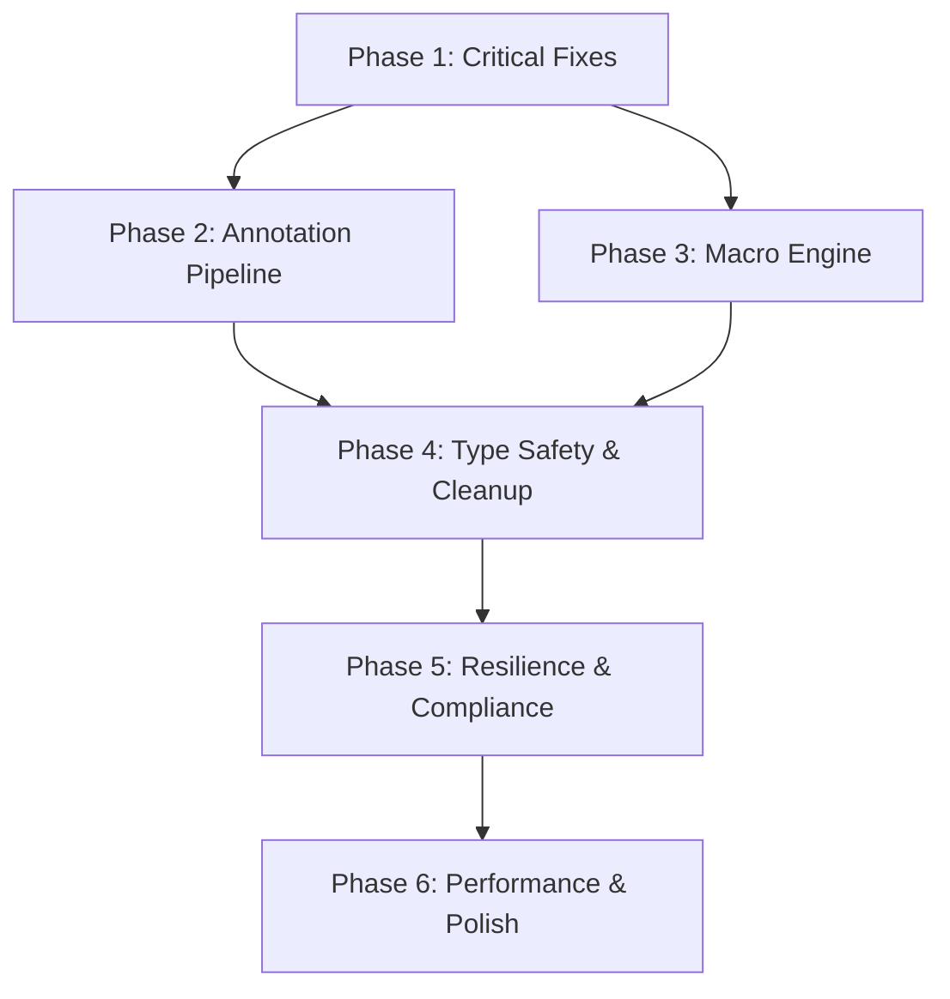

# DocCraft — Multi-Phase Work Instructions

**Date:** 2026-05-06  
**Sources:** Technical Audit + Appendix A (Annotations) + Appendix B (UI) + Appendix C (Macros) + Source-Level Macro Audit

---

## WI Execution Sequence



> [!IMPORTANT]
> Phase 1 is a prerequisite for all others. Phases 2 and 3 can run in parallel. Phases 4–6 are sequential.

---

## Phase 1: Critical Fixes (P0)

### WI-1.1 — Fix `searchDocumentText` Destroying Cached Document

**Audit Ref:** BUG-5  
**File:** [PdfRendererAdapter.ts](file:///c:/Users/reall/Downloads/Pdf-Hub-main%20(1)/Pdf-Hub-main/frontend/src/adapters/pdf-renderer/PdfRendererAdapter.ts#L278-L280)

**Root Cause:** The `finally` block at line 279 calls `doc.destroy()` on the shared cached document. After a search, all subsequent `renderPage` calls fail because the document proxy is invalidated.

**Fix:** Remove the `doc.destroy()` call from the search method. The cached document lifecycle is managed by `loadDocument`/`closeDocument`.

```diff
// PdfRendererAdapter.ts — searchDocumentText
     return hits;
-    } finally {
-      await doc.destroy();
-    }
+    } finally {
+      // Do NOT destroy — doc is the shared cached instance from loadDocument().
+      // Lifecycle is managed by closeDocument().
+    }
```

**Test:** Open a PDF → Search for text → Scroll to a different page. Page must render correctly after search completes.

---

### WI-1.2 — Delete All Merge-Conflict Artifacts

**Audit Ref:** Q-3

**Fix:** Run from `frontend/src`:
```powershell
Get-ChildItem -Recurse -Include *.orig,*.rej | Remove-Item -Force
```

**Test:** `Get-ChildItem -Recurse -Include *.orig,*.rej | Measure-Object` → Count = 0

---

### WI-1.3 — Add Error Boundaries to Major Zones

**Audit Ref:** BUG-2 / CB-3

**Create:** `components/ui/ErrorBoundary.tsx`

```tsx
import React from 'react';
import { error as logError } from '@/core/logger/service';

interface Props {
  zone: string;
  children: React.ReactNode;
}

interface State {
  hasError: boolean;
  errorMessage: string;
}

export class ErrorBoundary extends React.Component<Props, State> {
  state: State = { hasError: false, errorMessage: '' };

  static getDerivedStateFromError(err: Error): State {
    return { hasError: true, errorMessage: err.message };
  }

  componentDidCatch(err: Error, info: React.ErrorInfo) {
    logError('system', `Unhandled error in ${this.props.zone}`, {
      error: err.message,
      stack: err.stack,
      componentStack: info.componentStack,
    });
  }

  render() {
    if (this.state.hasError) {
      return (
        <div className="flex flex-col items-center justify-center h-full p-8 text-center">
          <p className="text-sm font-semibold text-red-600">
            Something went wrong in {this.props.zone}
          </p>
          <p className="text-xs text-slate-500 mt-1">{this.state.errorMessage}</p>
          <button
            className="mt-4 px-3 py-1.5 text-xs rounded bg-blue-600 text-white"
            onClick={() => this.setState({ hasError: false, errorMessage: '' })}
          >
            Try Again
          </button>
        </div>
      );
    }
    return this.props.children;
  }
}
```

**Wrap in AppShell:** Around `DocumentWorkspace`, `SidebarPanel`, and `InspectorPanel`:
```tsx
<ErrorBoundary zone="DocumentWorkspace">
  <DocumentWorkspace />
</ErrorBoundary>
```

**Test:** Throw an error inside DocumentWorkspace → Only that zone shows fallback UI. Sidebar and Inspector remain functional.

---

## Phase 2: Annotation Pipeline Fix (P1)

### WI-2.1 — Fix `ActiveTool` Type Union

**Audit Ref:** V-1, Q-8, Appendix A (tool mismapping)

**Root Cause:** `ActiveTool` has `'shape'` and `'freehand'` but the UI uses `'shape-rect'`, `'shape-ellipse'`, `'shape-polygon'`, `'shape-cloud'`, `'ink'`, `'callout'`, `'redaction'`, `'squiggly'`. This forces 8 `as any` casts.

**File:** [editor/types.ts](file:///c:/Users/reall/Downloads/Pdf-Hub-main%20(1)/Pdf-Hub-main/frontend/src/core/editor/types.ts#L1-L20)

```diff
 export type ActiveTool =
   | 'select'
   | 'hand'
   | 'textbox'
   | 'highlight'
   | 'underline'
   | 'strikeout'
   | 'squiggly'
-  | 'shape'
+  | 'shape-rect'
+  | 'shape-ellipse'
   | 'shape-cloud'
   | 'shape-polygon'
-  | 'freehand'
   | 'ink'
   | 'stamp'
   | 'sticky-note'
   | 'comment'
   | 'line'
   | 'arrow'
   | 'callout'
   | 'redaction';
```

Then in `ToolbarComment.tsx`, remove all `as any` casts — they will now type-check cleanly:
```diff
-onClick={() => handleToolClick('squiggly' as any)}
+onClick={() => handleToolClick('squiggly')}
```

**Test:** `grep -rn "as any" frontend/src/components/toolbar/ToolbarComment.tsx` → must be empty.

---

### WI-2.2 — Remove Duplicate Ink Button

**Audit Ref:** Q-2, Appendix A

**File:** [ToolbarComment.tsx L158-162](file:///c:/Users/reall/Downloads/Pdf-Hub-main%20(1)/Pdf-Hub-main/frontend/src/components/toolbar/ToolbarComment.tsx#L158-L162)

**Fix:** Delete the second Ink button block (lines 158–162). The first one at line 104 is the correct one.

```diff
-<Tooltip content="Ink">
-        <Button variant={getToolVariant('ink')} size="icon" onClick={() => handleToolClick('ink')}>
-          <PenTool className="w-4 h-4" />
-        </Button>
-      </Tooltip>
```

**Test:** Count PenTool icons in the Annotate ribbon → exactly 1.

---

### WI-2.3 — Complete KonvaAdapter Switch Statement

**Audit Ref:** Q-6, Appendix A ("ink: no paths" fallback)

**File:** [KonvaAdapter.ts L40-60](file:///c:/Users/reall/Downloads/Pdf-Hub-main%20(1)/Pdf-Hub-main/frontend/src/adapters/annotation-canvas/KonvaAdapter.ts#L40-L60)

**Reasoning:** The adapter only handles 6 of 18 annotation types. All others fall through to a gray rect. Add cases for every missing type:

```typescript
// Add these cases inside the switch(annotation.type):
case 'underline':
  node = new Konva.Line({
    ...config,
    points: [config.x, config.y + config.height, config.x + config.width, config.y + config.height],
    stroke: annotation.data.borderColor as string || 'red',
    strokeWidth: 2,
  });
  break;

case 'strikeout':
  node = new Konva.Line({
    ...config,
    points: [config.x, config.y + config.height / 2, config.x + config.width, config.y + config.height / 2],
    stroke: annotation.data.borderColor as string || 'red',
    strokeWidth: 2,
  });
  break;

case 'squiggly':
  // Wavy line approximation using tension
  const squigglyPoints: number[] = [];
  const step = 6;
  for (let i = 0; i <= config.width; i += step) {
    squigglyPoints.push(config.x + i, config.y + config.height + (i % (step * 2) === 0 ? -2 : 2));
  }
  node = new Konva.Line({ ...config, points: squigglyPoints, stroke: 'red', strokeWidth: 1.5 });
  break;

case 'line':
  node = new Konva.Line({
    ...config,
    points: [config.x, config.y, config.x + config.width, config.y + config.height],
    stroke: annotation.data.borderColor as string || '#1e293b',
    strokeWidth: annotation.data.borderWidth as number || 2,
  });
  break;

case 'arrow':
  node = new Konva.Arrow({
    ...config,
    points: [config.x, config.y, config.x + config.width, config.y + config.height],
    stroke: annotation.data.borderColor as string || '#1e293b',
    strokeWidth: 2,
    pointerLength: 8,
    pointerWidth: 6,
    fill: annotation.data.borderColor as string || '#1e293b',
  });
  break;

case 'callout':
  node = new Konva.Rect({
    ...config,
    stroke: '#2563eb',
    strokeWidth: 1.5,
    fill: '#eff6ff',
    cornerRadius: 4,
  });
  break;

case 'sticky-note':
  node = new Konva.Rect({
    ...config,
    fill: '#fef08a',
    stroke: '#ca8a04',
    strokeWidth: 1,
    cornerRadius: 2,
  });
  break;

case 'stamp':
  node = new Konva.Rect({
    ...config,
    stroke: '#dc2626',
    strokeWidth: 2,
    dash: [4, 2],
    cornerRadius: 4,
  });
  break;

case 'comment':
  node = new Konva.Circle({
    ...config,
    x: config.x + config.width / 2,
    y: config.y + config.height / 2,
    radius: Math.min(config.width, config.height) / 2,
    fill: '#3b82f6',
    opacity: 0.8,
  });
  break;

case 'redaction':
  node = new Konva.Rect({ ...config, fill: '#000000', opacity: 1 });
  break;
```

**Test:** Browser check — create each annotation type → no gray fallback rectangles. Each type renders a visually distinct shape.

---

## Phase 3: Macro Engine Fix (P1)

### WI-3.1 — Register Macro Step Executors at App Startup

**Audit Ref:** Appendix C (root cause of `Unknown op "rotate_pages"`)

**Root Cause (Source-Level):** `main.tsx` imports `@/core/annotations/register-all` but **never** imports `@/core/macro/steps/register-all`. The macro step executors (`rotate_pages`, `extract_pages`, etc.) are defined in `page-ops.ts`, `content-ops.ts`, etc. and call `macroRegistry.register(...)` at module scope. But since no code imports `register-all.ts`, these modules are **never loaded**, and the registry is empty at runtime. Only the test file (`expert.test.ts`) imports it.

The validator runs first and correctly reports: `Unknown op "rotate_pages". Not registered in macroRegistry.`

**File:** [main.tsx](file:///c:/Users/reall/Downloads/Pdf-Hub-main%20(1)/Pdf-Hub-main/frontend/src/main.tsx)

```diff
 import '@/core/annotations/register-all';
+import '@/core/macro/steps/register-all';
 import { StrictMode } from 'react';
```

**Test:**
1. Open PDF → Macro sidebar → Select "Rotate selected pages 90°" → Click "Run Macro"
2. Expected: Page rotates. Log shows `[step 1/1] rotate_pages: Rotated 1 page(s) by 90°`
3. Previously: `Unknown op "rotate_pages". Not registered in macroRegistry.`

---

### WI-3.2 — Fix Generation Macros (Double `adjust_image` Registration)

**Audit Ref:** Appendix C (Generate PDF silently fails)

**Source-Level Finding:** `generation-ops.ts` line 173 registers a **stub** for `adjust_image`:
```typescript
// generation-ops.ts:173
macroRegistry.register('adjust_image', executeAdjustImage); // STUB — returns success, does nothing
```

But `content-ops.ts` line 404 also registers a **real** implementation:
```typescript
// content-ops.ts:404
macroRegistry.register('adjust_image', executeAdjustImage); // REAL implementation
```

The winner depends on **import order** in `register-all.ts`. Currently: `page-ops` → `merge-ops` → `content-ops` → `generation-ops` → `conditional-ops`. So the stub in `generation-ops` wins and overwrites the real one.

**Fix:** Remove the stub from `generation-ops.ts` (lines 161–173):

```diff
-type AdjustImageStep = Extract<MacroStep, { op: 'adjust_image' }>;
-async function executeAdjustImage(
-  // eslint-disable-next-line @typescript-eslint/no-unused-vars
-  _step: AdjustImageStep,
-  // eslint-disable-next-line @typescript-eslint/no-unused-vars
-  _ctx: MacroExecutionContext,
-  // eslint-disable-next-line @typescript-eslint/no-unused-vars
-  _state: MacroMutableState,
-): Promise<StepResult> {
-  // Stub for Agent E
-  return { status: 'success', message: 'Adjust image stub', sideEffects: [] };
-}
-macroRegistry.register('adjust_image', executeAdjustImage);
```

**Test:** Run generation macro "Full Report (3 pages)" → 3 new pages are appended with content.

---

### WI-3.3 — Fix `pageRenderer.ts` Second `createRoot` (INV-1)

**Audit Ref:** BUG-1

**File:** [pageRenderer.ts](file:///c:/Users/reall/Downloads/Pdf-Hub-main%20(1)/Pdf-Hub-main/frontend/src/core/macro/layout/pageRenderer.ts#L28)

**Fix:** Replace `createRoot().render()` with `ReactDOMServer.renderToStaticMarkup()`:

```diff
-import { createRoot } from 'react-dom/client';
+import { renderToStaticMarkup } from 'react-dom/server';

// In renderPageToImageBytes:
-const root = createRoot(container);
-root.render(<PageLayout ... />);
+container.innerHTML = renderToStaticMarkup(<PageLayout ... />);
```

**Test:** `grep -rn "createRoot" frontend/src | wc -l` → must equal 1 (only `main.tsx`).

---

## Phase 4: Type Safety & Cleanup (P2)

### WI-4.1 — Cap Undo History Stack

**Audit Ref:** Q-7

**File:** [document-history/store.ts](file:///c:/Users/reall/Downloads/Pdf-Hub-main%20(1)/Pdf-Hub-main/frontend/src/core/document-history/store.ts#L19-L23)

```diff
+const MAX_UNDO_DEPTH = 15;
+
 push: (transaction) =>
   set((state) => ({
-    undoStack: [...state.undoStack, transaction],
+    undoStack: [...state.undoStack, transaction].slice(-MAX_UNDO_DEPTH),
     redoStack: [],
   })),
```

**Reasoning:** Each transaction stores full PDF bytes (before + after). A 10MB PDF with 20 undo steps = 400MB. Capping at 15 bounds memory to ~300MB worst-case.

**Test:** Perform 20 sequential edits → `undoStack.length` never exceeds 15.

---

### WI-4.2 — Remove Vite Boilerplate CSS

**Audit Ref:** E-7

**Fix:** Empty the contents of `App.css` or delete it if no legitimate styles exist.

---

### WI-4.3 — Add IBM Plex Sans Font Import

**Audit Ref:** E-2

**File:** `frontend/index.html`

```html
<link rel="preconnect" href="https://fonts.googleapis.com">
<link href="https://fonts.googleapis.com/css2?family=IBM+Plex+Sans:wght@400;500;600;700&family=IBM+Plex+Mono&display=swap" rel="stylesheet">
```

**Test:** Inspect body font in DevTools → `IBM Plex Sans`, not system fallback.

---

### WI-4.4 — Add `typecheck` Script

**Audit Ref:** E-1

**File:** `frontend/package.json`

```diff
 "scripts": {
   "dev": "vite",
   "build": "vite build",
+  "typecheck": "tsc --noEmit",
```

---

## Phase 5: Resilience & Compliance (P2)

### WI-5.1 — Create PreviewModeBanner

**Audit Ref:** BUG-3 / INV-9

**Create:** `components/shell/PreviewModeBanner.tsx`

```tsx
import React from 'react';

export const PreviewModeBanner: React.FC = () => (
  <div className="bg-amber-500 text-amber-950 text-xs font-medium text-center py-1.5 px-4 select-none">
    Running in preview mode. Start the local server for full features.
  </div>
);
```

**Add to AppShell** at the top of the layout, before the TopNav. It must be non-dismissible per INV-9.

**Test:** Banner visible at top of page. No close/dismiss button exists.

---

### WI-5.2 — Create `useCapabilities` Hook

**Audit Ref:** BUG-4 / INV-5

**Create:** `hooks/useCapabilities.ts`

```tsx
import { useState, useEffect } from 'react';

export type AppMode = 'preview' | 'server';

interface Capabilities {
  mode: AppMode;
  serverAlive: boolean;
  hasServerOcr: boolean;
  hasMacroConsole: boolean;
}

export function useCapabilities(): Capabilities {
  const [serverAlive, setServerAlive] = useState(false);

  useEffect(() => {
    fetch('/api/health', { signal: AbortSignal.timeout(2000) })
      .then(r => setServerAlive(r.ok))
      .catch(() => setServerAlive(false));
  }, []);

  const mode: AppMode = serverAlive ? 'server' : 'preview';

  return {
    mode,
    serverAlive,
    hasServerOcr: serverAlive,
    hasMacroConsole: serverAlive,
  };
}
```

**Test:** In preview mode (no backend), `useCapabilities().mode === 'preview'` and server-only features are hidden (not broken).

---

### WI-5.3 — Remove DebugPage Double-Guard

**Audit Ref:** V-3

**File:** [DebugPage.tsx L9](file:///c:/Users/reall/Downloads/Pdf-Hub-main%20(1)/Pdf-Hub-main/frontend/src/pages/DebugPage.tsx#L9)

Remove the inner `if (!import.meta.env.DEV)` guard and `window.location.replace('/')`. The route is already guarded in `App.tsx`.

---

### WI-5.4 — Singleton Tesseract Worker

**Audit Ref:** Q-5

**File:** [clientOcr.ts](file:///c:/Users/reall/Downloads/Pdf-Hub-main%20(1)/Pdf-Hub-main/frontend/src/core/ocr/clientOcr.ts)

```typescript
let workerInstance: Awaited<ReturnType<typeof import('tesseract.js')['createWorker']>> | null = null;

async function getWorker() {
  if (!workerInstance) {
    const Tesseract = await import('tesseract.js');
    workerInstance = await Tesseract.createWorker('eng');
  }
  return workerInstance;
}

export async function recognizeImage(base64DataUrl: string): Promise<string> {
  const worker = await getWorker();
  const ret = await worker.recognize(base64DataUrl);
  return ret.data.text;
}

export async function terminateOcrWorker(): Promise<void> {
  if (workerInstance) {
    await workerInstance.terminate();
    workerInstance = null;
  }
}
```

**Test:** Call `recognizeImage` twice in sequence → second call completes in <500ms (no re-init).

---

## Phase 6: Performance & Polish (P3)

### WI-6.1 — Normalize Line Endings

**Audit Ref:** Q-4

Add `.gitattributes`:
```
* text=auto eol=lf
*.ts text eol=lf
*.tsx text eol=lf
```

### WI-6.2 — Make Vite `base` Configurable

**Audit Ref:** E-5

```diff
// vite.config.ts
-  base: '/Pdf-Hub/',
+  base: process.env.VITE_BASE_PATH || '/Pdf-Hub/',
```

### WI-6.3 — Fix `pagehide` Listener Re-registration

**Audit Ref:** E-6

Move the `pagehide` listener to a separate one-time `useEffect` in DocumentWorkspace so it doesn't re-register on every annotation change.

---

## Pre-Commit Checklist (per AGENTS.md §9)

After all phases:

| Check | Command |
|-------|---------|
| fitz only in pdf_engine? | N/A (no backend yet) |
| Single createRoot? | `grep -rn "createRoot" frontend/src \| wc -l` → 1 |
| Domain types clean? | `grep -rn "import konva" frontend/src/core/` → empty |
| No `as any` in toolbar? | `grep -rn "as any" frontend/src/components/toolbar/` → empty |
| No console.log? | `grep -rn "console.log" frontend/src/` → empty |
| Preview banner visible? | Browser check |
| Annotations not in localStorage? | `grep -rn "localStorage" frontend/src/` → only theme |
| Tests pass? | `npm test` |

---

## Summary Table

| Phase | WI | Issue | Effort | Blocks |
|-------|-----|-------|--------|--------|
| 1 | 1.1 | Search destroys cached doc | 5 min | — |
| 1 | 1.2 | Delete .orig/.rej files | 5 min | — |
| 1 | 1.3 | Add ErrorBoundaries | 20 min | — |
| 2 | 2.1 | Fix ActiveTool type | 10 min | — |
| 2 | 2.2 | Remove duplicate Ink button | 2 min | WI-2.1 |
| 2 | 2.3 | Complete KonvaAdapter | 30 min | WI-2.1 |
| 3 | 3.1 | **Register macro steps at startup** | 2 min | — |
| 3 | 3.2 | Remove adjust_image stub | 5 min | WI-3.1 |
| 3 | 3.3 | Eliminate second createRoot | 15 min | — |
| 4 | 4.1 | Cap undo history | 5 min | — |
| 4 | 4.2 | Remove boilerplate CSS | 2 min | — |
| 4 | 4.3 | Load IBM Plex Sans | 2 min | — |
| 4 | 4.4 | Add typecheck script | 2 min | — |
| 5 | 5.1 | PreviewModeBanner | 10 min | — |
| 5 | 5.2 | useCapabilities hook | 15 min | WI-5.1 |
| 5 | 5.3 | Remove debug double-guard | 2 min | — |
| 5 | 5.4 | Singleton Tesseract worker | 15 min | — |
| 6 | 6.1 | Normalize line endings | 5 min | — |
| 6 | 6.2 | Configurable Vite base | 5 min | — |
| 6 | 6.3 | Fix pagehide listener | 10 min | — |
