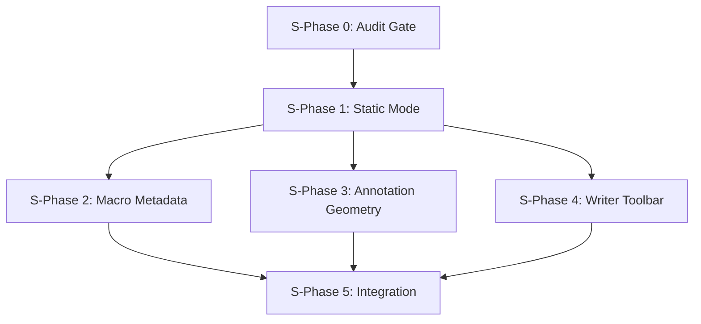

# DocCraft — Agent Prompts for Phase-Wise Coding

> Each prompt below is a self-contained instruction set for one phase.
> Copy-paste the relevant prompt to a coding agent to execute that phase.
> Phases MUST execute in order: 0 → 1 → 2 → 3 → 4 → 5.

---

## How To Use

1. Copy the prompt for the phase you want to execute
2. Give it to a coding agent (e.g., `/goal` slash command for long-running)
3. The agent should execute every work item and run the acceptance gate
4. Only proceed to the next phase after acceptance passes

---

# S-PHASE 0 — Baseline Audit & Release Gate

````
You are a coding agent working on DocCraft, a React PDF editor at c:\Code1\Pdf-Hub.

## Your Task
Create a single `check:release` command that consolidates all verification into one gate.
Expand the static contract checker. Generate a machine-readable audit report.

## Rules (ALWAYS follow)
- AGENTS.md at project root governs everything. Read it before coding.
- Never use `console.log` in source files. Use `import { info, warn, debug, error } from '@/core/logger/service'` instead.
- Import paths use `@/` alias (maps to `./src/` via vite.config.ts).
- This is a frontend-only project. There is NO backend/ directory.
- Run on Windows with PowerShell. `grep` is NOT available — use PowerShell equivalents or Node.js scripts.

## Work Item 1: Expand static-contract-checks.mjs

File: `frontend/scripts/static-contract-checks.mjs`

This file currently has 7 checks. ADD these new checks after the existing ones (before the summary block at line 55):

```javascript
// ── S-Phase 0: Additional contract checks ────────────────────

// No raw fetch() in component files (only capability service should fetch)
check(
  'no raw fetch in components',
  'fetch\\(',
  'components',
  0,
  { includeTests: false },
);

// No localStorage for any persistence in core/
check(
  'no localStorage in core persistence',
  'localStorage\\.(setItem|getItem)',
  'core',
  0,
);

// Verify macro register-all imports exactly 4 step modules
check(
  'macro register-all has 4 step imports',
  "import '\\./",
  'core/macro/steps',
  4,
  { includeTests: false },
);
```

IMPORTANT: The existing `grepMatches` function uses `grep` which doesn't work on Windows.
You MUST rewrite the function to use a cross-platform approach. Replace the `grep` spawn with
a recursive file search using Node.js `fs` and `path`:

```javascript
import { readdirSync, readFileSync, statSync } from 'fs';

function findFiles(dir, extensions = ['.ts', '.tsx']) {
  const results = [];
  for (const entry of readdirSync(dir, { withFileTypes: true })) {
    const fullPath = path.join(dir, entry.name);
    if (entry.isDirectory() && !entry.name.startsWith('.') && entry.name !== 'node_modules') {
      results.push(...findFiles(fullPath, extensions));
    } else if (extensions.some(ext => entry.name.endsWith(ext))) {
      results.push(fullPath);
    }
  }
  return results;
}

function grepMatches(pattern, dir = null, includeTests = true) {
  const searchDir = dir ? path.join(srcDir, dir) : srcDir;
  const regex = new RegExp(pattern);
  const files = findFiles(searchDir);
  const matches = [];

  for (const file of files) {
    if (!includeTests && /[.](test|spec)[.]/.test(file)) continue;
    const lines = readFileSync(file, 'utf8').split('\n');
    for (let i = 0; i < lines.length; i++) {
      if (regex.test(lines[i])) {
        matches.push(`${file}:${i + 1}:${lines[i].trim()}`);
      }
    }
  }
  return matches;
}
```

Also add AUDIT_REPORT.json generation at the end of the file:

```javascript
import { writeFileSync } from 'fs';

// After the summary console.log, before process.exit:
const report = {
  timestamp: new Date().toISOString(),
  pass: failCount === 0,
  failures: failCount,
  phase: 'S-Phase-0',
};
writeFileSync(
  path.join(repoRoot, '..', 'AUDIT_REPORT.json'),
  JSON.stringify(report, null, 2),
);
```

## Work Item 2: Add check:release to package.json

File: `frontend/package.json`

Find the `"scripts"` section. Add this new script (after `check:all`):

```json
"check:release": "npm run typecheck && npm run lint && npm test && npm run check:static && npm run build"
```

Do NOT remove any existing scripts. Just add the new one.

## Work Item 3: Run and Fix

Run: `pnpm --dir frontend check:release`

If any check fails, fix the issue. Common problems:
- If `check:static` fails because of the grep rewrite, debug the Node.js version
- If `lint` fails, fix the lint errors (check knownissues.md for known ESLint issues)
- If `build` fails with TypeScript errors, fix them
- If `test` fails, investigate and fix the failing tests

## Acceptance Gate

These commands MUST all exit 0:
```
pnpm --dir frontend check:release
```

And this file MUST exist:
```
AUDIT_REPORT.json
```

## What NOT To Do
- Do NOT add console.log anywhere in src/ files
- Do NOT modify any test files unless they are broken
- Do NOT remove existing checks from static-contract-checks.mjs
- Do NOT change the build configuration
- Do NOT install new dependencies
````

---

# S-PHASE 1 — Static Mode Hardening

````
You are a coding agent working on DocCraft, a React PDF editor at c:\Code1\Pdf-Hub.

## Your Task
Introduce a three-mode capability system: 'static' | 'preview' | 'server'.
Static mode = zero network calls, all client features work.
Update the PreviewModeBanner, route guards, and tests.

## Rules (ALWAYS follow)
- AGENTS.md at project root governs everything. Read it first.
- Never use console.log. Use `@/core/logger/service`.
- Import paths use `@/` alias.
- Frontend only — no backend/ directory exists.
- Logger sources are: 'system' | 'capabilities' | 'session' | 'pdf-renderer' | 'ocr' | 'annotation' | 'macro' | 'writer'

## Context: Current State

### useCapabilities.ts (current)
Location: `frontend/src/hooks/useCapabilities.ts`
- Exports: `type AppMode = 'preview' | 'server'`
- Exports: `interface Capabilities` with boolean flags
- Exports: `detectCapabilities()` — always probes /api/health
- Exports: `useCapabilities()` — React hook with cached singleton
- Module-level state: `cachedCapabilities`, `detectionPromise`, `lastLoggedSignature`

### PreviewModeBanner.tsx (current)
Location: `frontend/src/components/shell/PreviewModeBanner.tsx`
- Simple component, no props, hardcoded text
- Used in AppShell.tsx: `{capabilities.mode === 'preview' && <PreviewModeBanner />}`

### App.tsx (current)
Location: `frontend/src/App.tsx`
- Macro route: `capabilities.hasMacroConsole ? <MacroBuilderPage /> : <Navigate to="/" replace />`
- This means macro builder is HIDDEN in preview/static mode — we need to fix this

### Env files
- `frontend/.env.development`: `VITE_BASE_PATH=/Pdf-Hub/`
- `frontend/.env.production`: `VITE_BASE_PATH=/Pdf-Hub/`
- No `VITE_APP_MODE` exists yet

## Work Item 1: Rewrite useCapabilities.ts

Replace `frontend/src/hooks/useCapabilities.ts` entirely. The new version must:

1. Export `type AppMode = 'static' | 'preview' | 'server'`
2. Export expanded `interface Capabilities` with granular flags:
   - `canUseClientPdfTools: boolean` (always true)
   - `canUseClientAnnotations: boolean` (always true)
   - `canUseClientWriter: boolean` (always true)
   - `canUseClientMacros: boolean` (always true)
   - `canUseServerOcr: boolean` (true only in server mode)
   - `canUseServerAnnotations: boolean` (true only in server mode)
   - `canUseMacroApi: boolean` (true only in server mode)
   - `canProbeServer: boolean` (false in static mode)
   - Keep legacy aliases: `hasServerOcr`, `hasPreviewOcr`, `hasMacroConsole`, `hasServerAnnotations`
3. Read `import.meta.env.VITE_APP_MODE` to determine initial mode:
   - `'static'` → never probe server, return static capabilities immediately
   - `'server'` → probe server
   - anything else / undefined → `'preview'` mode, probe server once
4. Keep the same caching pattern (module-level `cachedCapabilities` and `detectionPromise`)
5. Export a `createTestCapabilities(mode, overrides?)` helper for tests
6. Use `log('capabilities', ...)` for logging (same as current)

Key behavioral difference from current code:
```typescript
// In detectCapabilities():
const initialMode = getInitialMode(); // reads VITE_APP_MODE
if (initialMode === 'static') {
  return STATIC_CAPABILITIES; // NO fetch call, NO network
}
// ... rest is same as current (probe /api/health)
```

## Work Item 2: Create .env.static

Create file: `frontend/.env.static`
```
VITE_APP_MODE=static
VITE_BASE_PATH=/Pdf-Hub/
```

## Work Item 3: Update PreviewModeBanner.tsx

Replace `frontend/src/components/shell/PreviewModeBanner.tsx`:

```tsx
import React from 'react';
import type { AppMode } from '@/hooks/useCapabilities';

interface ModeBannerProps {
  mode: AppMode;
}

const BANNER_TEXT: Record<Exclude<AppMode, 'server'>, string> = {
  static: 'Running in static mode. Some features require a local server.',
  preview: 'Running in preview mode. Start the local server for full features.',
};

/**
 * Always-visible indicator for non-server modes. INV-9: non-dismissible.
 */
export const PreviewModeBanner: React.FC<ModeBannerProps> = ({ mode }) => {
  if (mode === 'server') return null;

  return (
    <div
      role="status"
      aria-live="polite"
      className="shrink-0 w-full bg-amber-400 text-amber-950 px-4 py-1.5 text-center text-xs font-semibold select-none"
    >
      {BANNER_TEXT[mode]}
    </div>
  );
};
```

## Work Item 4: Update AppShell.tsx

In `frontend/src/components/shell/AppShell.tsx`, find the line:
```tsx
{capabilities.mode === 'preview' && <PreviewModeBanner />}
```

Replace with:
```tsx
<PreviewModeBanner mode={capabilities.mode} />
```

The banner component now handles mode checking internally.

## Work Item 5: Update App.tsx Macro Route

In `frontend/src/App.tsx`, find line 22:
```tsx
<Route path="/macro-builder" element={capabilities.hasMacroConsole ? <MacroBuilderPage /> : <Navigate to="/" replace />} />
```

Replace with:
```tsx
<Route path="/macro-builder" element={capabilities.canUseClientMacros ? <MacroBuilderPage /> : <Navigate to="/" replace />} />
```

`canUseClientMacros` is always true, so macro builder is now available in ALL modes.

## Work Item 6: Update main.tsx startup log

In `frontend/src/main.tsx`, the `emitStartupLog` call currently hardcodes 'preview'.
It should detect the mode:

Find: `emitStartupLog('preview', '0.0.0', navigator.userAgent);`
Replace with: `emitStartupLog(import.meta.env.VITE_APP_MODE ?? 'preview', '0.0.0', navigator.userAgent);`

## Work Item 7: Rewrite useCapabilities.test.ts

Replace `frontend/src/hooks/useCapabilities.test.ts` with tests that cover:

1. **Static mode**: When `VITE_APP_MODE=static`, `detectCapabilities()` returns static caps without calling fetch
2. **Preview mode (default)**: When VITE_APP_MODE is empty and fetch fails, returns preview caps
3. **Server mode**: When fetch succeeds, returns server caps
4. **createTestCapabilities helper**: Creates correct caps for each mode and accepts overrides

Test pattern (matching existing codebase style):
```typescript
import { afterEach, beforeEach, describe, expect, it, vi } from 'vitest';

const loadModule = async () => {
  vi.resetModules();
  return import('./useCapabilities');
};

describe('detectCapabilities', () => {
  beforeEach(() => {
    vi.useFakeTimers();
  });

  afterEach(() => {
    vi.unstubAllGlobals();
    vi.unstubAllEnvs();
    vi.useRealTimers();
  });

  it('static mode: no fetch, all client caps true, all server caps false', async () => {
    vi.stubEnv('VITE_APP_MODE', 'static');
    vi.stubGlobal('fetch', vi.fn());
    const { detectCapabilities } = await loadModule();
    const caps = await detectCapabilities();

    expect(caps.mode).toBe('static');
    expect(caps.canUseClientMacros).toBe(true);
    expect(caps.canUseServerOcr).toBe(false);
    expect(caps.canProbeServer).toBe(false);
    expect(fetch).not.toHaveBeenCalled();
  });

  // ... add preview and server tests similarly
});
```

## Work Item 8: Create App.staticMode.test.tsx

Create `frontend/src/App.staticMode.test.tsx`:
- Mock `useCapabilities` to return static mode capabilities
- Verify: `fetch` is never called
- Verify: mode banner shows "static mode" text
- Verify: no server-only buttons render

Follow the exact mock pattern from `App.slice11.test.tsx`:
```typescript
vi.mock('@/hooks/useCapabilities', () => ({
  useCapabilities: () => ({
    mode: 'static' as const,
    // ... all fields
  }),
}));
```

Also mock `react-resizable-panels`, `DocumentWorkspace`, and `SidebarPanel` exactly as done in `App.test.tsx`.

## Work Item 9: Fix all consumers of PreviewModeBanner

Search all files that import `PreviewModeBanner`. Update them to pass the `mode` prop.
The main consumer is `AppShell.tsx` (Work Item 4). Check if there are others:
```
Get-ChildItem -Recurse -Include *.ts,*.tsx frontend\src | Select-String "PreviewModeBanner"
```

## Acceptance Gate

Run all of these — every one MUST exit 0:
```
pnpm --dir frontend typecheck
pnpm --dir frontend lint
pnpm --dir frontend test
pnpm --dir frontend check:static
pnpm --dir frontend build
```

Or the combined:
```
pnpm --dir frontend check:release
```

## What NOT To Do
- Do NOT use import.meta.env to gate FEATURES (INV-5). Only use it for initial MODE detection.
- Do NOT remove the legacy `hasMacroConsole` / `hasServerOcr` etc. fields — keep them as aliases for backward compat.
- Do NOT add console.log anywhere.
- Do NOT create a CapabilityProvider React context — keep the hook pattern.
- Do NOT modify any files outside frontend/src/ except .env files and package.json.
````

---

# S-PHASE 2 — Macro Mode Awareness + WordPad Rich Text Foundation

````
You are a coding agent working on DocCraft, a React PDF editor at c:\Code1\Pdf-Hub.

## Your Task
(A) Create a macro metadata system that declares each op as client/server/hybrid.
(B) Build custom Lexical nodes for inline images, tables, and headings inside the writer editor.

## Rules
- AGENTS.md governs. No console.log. Use @/ imports. Frontend only.
- Logger sources: 'system' | 'capabilities' | 'session' | 'pdf-renderer' | 'ocr' | 'annotation' | 'macro' | 'writer'
- All 22 ops are currently client-mode (no backend exists). Design the metadata to support future server ops.
- INV-4: Domain types in core/ must not reference library types.
- Lexical is already installed: @lexical/history, @lexical/html, @lexical/list,
  @lexical/selection, @lexical/react, @lexical/rich-text, @lexical/table

## Context: Current Macro System

### Registered Ops (from register-all.ts)
All 22 ops, all client-side via pdf-lib:
```
rotate_pages, extract_pages, split_pages, duplicate_pages,
remove_pages, insert_blank_page, replace_page, reorder_pages,
select_pages, merge_files, insert_pdf,
header_footer_text, draw_text_on_pages, inject_rich_text,
insert_image, add_content_page, add_image_header_page,
place_rich_textbox, place_table, adjust_image,
conditional, apply_template_vars
```

### Registry (registry.ts)
- `MacroStepRegistry` class with `register()`, `has()`, `getRegisteredOps()`, `execute()`
- Singleton: `export const macroRegistry = new MacroStepRegistry()`

### Current Lexical Config (WriterPopupEditor.tsx)
Currently registered nodes: ListNode, ListItemNode, TableNode, TableRowNode, TableCellNode.
MISSING: HeadingNode, ImageNode (custom), LinkNode.
Popup editor toolbar has: font family, font size, color, B/I/U/S, alignment, lists.

## Work Item 1: Create metadata.ts

Create file: `frontend/src/core/macro/metadata.ts`

Full code is in implementation_plan.md S-Phase 2.1. Key exports:
- `MacroOpMetadata` interface with op, mode, category, label, description, requiresDocument, requiresSelection
- `MACRO_OP_METADATA` — Record with entries for ALL 22 ops (all mode: 'client')
- `getAvailableOps(capabilities)` — filter by current mode
- `getUnavailableReason(op, capabilities)` — null if available, reason string if not
- `validateRecipeForMode(steps, capabilities)` — batch validation

## Work Item 2: Create metadata.test.ts

Create file: `frontend/src/core/macro/metadata.test.ts`
Tests: 22-op coverage, static mode availability, server mode availability, unknown op handling, recipe validation.
Use `createTestCapabilities` from `@/hooks/useCapabilities`.

## Work Item 3: Create ImageNode (Lexical Custom Node)

Create file: `frontend/src/core/writer-v2/lexical-nodes/ImageNode.ts`

This is a `DecoratorNode<JSX.Element>` for inline/block images inside rich text.
Key requirements:
- Type: `'inline-image'`
- Fields: src, altText, width (number|'inherit'), height (number|'inherit'), caption
- Full serialization: `importJSON()`, `exportJSON()`
- DOM: `createDOM()` returns `<figure contenteditable="false">`
- DOM import: converts `` elements
- Helpers: `$createImageNode()`, `$isImageNode()`
- Mutation: `setWidthHeight()`, `setCaption()`, `getSrc()`

Full code is in implementation_plan.md S-Phase 2.3a.

## Work Item 4: Create tableHelpers.ts

Create file: `frontend/src/core/writer-v2/lexical-nodes/tableHelpers.ts`

Uses existing `@lexical/table` package. Exports:
- `insertTable(editor, rows, cols)` — clamps rows 1-50, cols 1-20
- `insertTableFromData(editor, data: string[][])` — for CSV/clipboard import
- Re-exports: `TableNode, TableRowNode, TableCellNode`

Full code is in implementation_plan.md S-Phase 2.3b.

## Work Item 5: Create headingHelpers.ts

Create file: `frontend/src/core/writer-v2/lexical-nodes/headingHelpers.ts`

Uses `@lexical/rich-text` HeadingNode. Exports:
- `toggleHeading(editor, level: HeadingTagType)` — toggle or convert back to paragraph
- Re-exports: `HeadingNode`

Full code is in implementation_plan.md S-Phase 2.3c.

## Work Item 6: Register nodes in WriterPopupEditor.tsx

Modify: `frontend/src/components/writer-v2/WriterPopupEditor.tsx`

Find the `initialConfig.nodes` array and ADD: `ImageNode, HeadingNode`
(TableNode/TableRowNode/TableCellNode are already there)

Also add after existing plugins inside `<LexicalComposer>`:
```tsx
import { ListPlugin } from '@lexical/react/LexicalListPlugin';
// ListPlugin may already be present — check first
```

If HeadingNode is not imported, add:
```tsx
import { HeadingNode } from '@/core/writer-v2/lexical-nodes/headingHelpers';
import { ImageNode } from '@/core/writer-v2/lexical-nodes/ImageNode';
```

## Work Item 7: Create custom node tests

Create: `frontend/src/core/writer-v2/lexical-nodes/ImageNode.test.ts`
Tests: type identifier, JSON serialization, importJSON round-trip, $createImageNode, $isImageNode, defaults.

Create: `frontend/src/core/writer-v2/lexical-nodes/tableHelpers.test.ts`
Tests: re-exports exist, insertTable is callable, insertTableFromData is callable.

Full test code is in implementation_plan.md S-Phase 2.4.

## Acceptance Gate

```
pnpm --dir frontend check:release
```

Must exit 0. All new tests must pass.

## What NOT To Do
- Do NOT modify registry.ts or types.ts — metadata is a PARALLEL system, not a replacement
- Do NOT change how macros execute — only add metadata queries
- Do NOT add server-mode ops yet (no backend exists)
- Do NOT import Konva or pdfjs-dist in any core/ file (INV-4)
- Do NOT replace WriterPopupEditor — only add node registrations
- Do NOT add toolbar buttons yet (that's Phase 4)
````

---

# S-PHASE 3 — Annotation Coordinate Stability & Persistence Hardening

````
You are a coding agent working on DocCraft, a React PDF editor at c:\Code1\Pdf-Hub.

## Your Task
Add an AnnotationGeometry contract type that bridges annotation types with the
existing normalized geometry system. Add coordinate stability tests for zoom and rotation.
Verify persistence uses IndexedDB, never localStorage. Add batch reprojection utilities.

## Rules
- AGENTS.md governs. No console.log. Use @/ imports. Frontend only.
- INV-10: No localStorage for annotation data. IndexedDB only.
- INV-4: Domain types in core/ must not reference library types (no Konva, no pdfjs-dist).

## Context: What Already Exists

### Annotation Types (core/annotations/types.ts)
- `Rect { x, y, width, height }`
- `Point2D { x, y }`
- `PdfAnnotation { id, type, pageNumber, rect, data, createdAt, updatedAt }`
- `data.normalizedGeometry?: unknown` — stores normalized form
- `data.geometryVersion?: number` — migration version

### Normalized Geometry (core/annotations/normalized.ts — 224 lines)
Already has:
- `NormalizedAnnotationGeometry { rect: NormRect, anchor?, knee?, points?, paths? }`
- `normalizeRect()`, `denormalizeRect()`, `normalizePoint()`, `denormalizePoint()`
- `rotateNormRect()`, `rotateNormPoint()`, `rotateNormPath()`
- `normalizeAnnotationGeometry()`, `denormalizeAnnotationGeometry()`
- `migrateAnnotationToNormalized()`, `migrateAnnotationFromNormalized()`
- `ensureAnnotationHasNormalizedGeometry()`

### Coordinate Transforms (core/writer-v2/)
Already has: PdfRect, ViewportRect, PdfPoint, ViewportPoint, WriterPageViewport, full transforms.

### Persistence (core/annotations/persistence.ts)
- Uses `idb` library (IndexedDB wrapper) — keyed by document hash, schema v2
- NO localStorage anywhere

### Page Remapper (core/annotations/pageRemapper.ts)
Already handles: reorder, delete, insert, rotate, duplicate operations on annotations.

## Work Item 1: Create geometry.ts

Create file: `frontend/src/core/annotations/geometry.ts`

Full code is in implementation_plan.md S-Phase 3.1. Key exports:
- `PageRotation = 0 | 90 | 180 | 270`
- `AnnotationGeometry` interface — page context + viewport rect + normalized coords
- `createAnnotationGeometry(pageNumber, rotation, width, height, rect)` — with zero-dimension guard
- `reprojectGeometry(geometry, newWidth, newHeight)` — zoom stability
- `reprojectForRotation(geometry, newRotation, newWidth, newHeight)` — rotation stability
- `batchReproject(geometries[], newWidth, newHeight)` — batch zoom update

## Work Item 2: Create geometry.test.ts

Create file: `frontend/src/core/annotations/geometry.test.ts`

Full test code is in implementation_plan.md S-Phase 3.2. Test scenarios:
1. Creates geometry with normalized coords in [0,1] range (US Letter 612×792)
2. Reprojects to 2× size (zoom simulation) — viewport coords double, normalized stay same
3. Round-trip at same size within 0.01 tolerance
4. Non-standard page sizes (A4: 595×842) — center point normalizes to ~0.5
5. Zero-width protection — uses Math.max(1, ...) internally
6. Rotation: updates rotation and page dimensions, recalculates viewport
7. Batch reproject: multiple geometries at once
8. Multi-operation stability: zoom→un-zoom round-trip preserves coords
9. Progressive zoom: 1x→1.5x→2x→1x preserves original positions

## Work Item 3: Create persistence.contract.test.ts

Create file: `frontend/src/core/annotations/persistence.contract.test.ts`

Tests (using fs.readFileSync to check source files):
1. persistence.ts does not contain 'localStorage'
2. store.ts does not contain 'localStorage'
3. persistence.ts contains 'idb' import
4. No .ts file in core/annotations/ uses localStorage

Full test code is in implementation_plan.md S-Phase 3.3.

## Acceptance Gate

```
pnpm --dir frontend check:release
```

## What NOT To Do
- Do NOT modify normalized.ts — it's already correct and tested
- Do NOT modify store.ts — it already uses page remappers correctly
- Do NOT modify persistence.ts — it already uses IndexedDB correctly
- Do NOT import Konva or pdfjs-dist in any core/ file (INV-4)
- Do NOT replace NormalizedAnnotationGeometry — extend/wrap it
````

---

# S-PHASE 4 — WordPad-Style Toolbar, Image/Table Insertion & Export Pipeline

````
You are a coding agent working on DocCraft, a React PDF editor at c:\Code1\Pdf-Hub.

## Your Task
Complete the WordPad-like editing experience:
(A) Wire Lexical custom nodes (from Phase 2) into toolbar buttons
(B) Add image insertion via file picker + drag-and-drop
(C) Add table insertion dialog + clipboard paste-as-table
(D) Fix export pipeline to preserve rich formatting (bold/italic/font/color)

## User Priority
"Table import, rich text, image insertion, 'WordPad' Like user interface for editing is priority."
Find/replace is explicitly de-prioritized.

## Rules
- AGENTS.md governs. No console.log. Use @/ imports. Frontend only.
- The writer-v2 command model (17 commands, 50-deep undo/redo) is in writerCommandStore.ts.
  DO NOT rewrite it. DO NOT replace it.
- Lexical is already installed: @lexical/history, @lexical/html, @lexical/list,
  @lexical/selection, @lexical/react, @lexical/rich-text, @lexical/table

## Context: What Already Exists

### Existing Main Toolbar (WriterV2ToolbarControls.tsx — 7.6 KB)
Currently has 6 buttons: Text Box, Callout, Copy Region, Flatten, Save Project, Open Project.
MISSING: Font controls, image insert, table insert, undo/redo buttons.

### Existing Popup Editor Toolbar (inside WriterPopupEditor.tsx — 14.6 KB)
Has: font family, font size, color, B/I/U/S, alignment, lists.
MISSING: headings, insert image, insert table, highlight color.

### Custom Nodes (from Phase 2)
Available at: `@/core/writer-v2/lexical-nodes/`
- `ImageNode` — inline/block images in rich text
- `tableHelpers` — insertTable(), insertTableFromData()
- `headingHelpers` — toggleHeading()

### Export Pipeline (flattenedPdfExport.ts)
Currently uses ONLY `plainText` — all rich formatting is lost on export.

## Work Item 1: Audit Existing Toolbar

FIRST, read `WriterV2ToolbarControls.tsx` and `WriterPopupEditor.tsx` fully.
List what controls already exist. Only add what's missing.

WordPad checklist:
- [ ] Font family selector → `$patchStyleText(selection, { 'font-family': value })`
- [ ] Font size selector → `$patchStyleText(selection, { 'font-size': value + 'px' })`
- [ ] Bold/Italic/Underline/Strikethrough → `FORMAT_TEXT_COMMAND`
- [ ] Text color picker → `$patchStyleText(selection, { color: hex })`
- [ ] Highlight color → `$patchStyleText(selection, { 'background-color': hex })`
- [ ] Heading selector (H1-H3) → `toggleHeading(editor, 'h1')`
- [ ] Bullet/Numbered list → `INSERT_UNORDERED_LIST_COMMAND`
- [ ] Text alignment (L/C/R) → `FORMAT_ELEMENT_COMMAND`
- [ ] Insert image button → file picker + `$createImageNode()`
- [ ] Insert table button → size dialog + `insertTable()`

## Work Item 2: Add Missing Toolbar Controls

Full component code is in implementation_plan.md S-Phase 4.1.
Key components to create/add:
- FontFamilyDropdown, FontSizeDropdown
- TextColorPicker, HighlightColorPicker
- InsertImageButton (with file picker)
- InsertTableButton (with rows/cols dialog)
- HeadingDropdown

Group in toolbar: Text format | Style | Color | List | Alignment | Insert | Indent

## Work Item 3: Create ImageDropPlugin

Create: `frontend/src/components/writer-v2/plugins/ImageDropPlugin.tsx`
Lexical plugin for drag-and-drop image insertion.
Add `<ImageDropPlugin />` inside `<LexicalComposer>` in WriterPopupEditor.tsx.

Full code is in implementation_plan.md S-Phase 4.2.

## Work Item 4: Create TablePastePlugin

Create: `frontend/src/components/writer-v2/plugins/TablePastePlugin.tsx`
Detects pasted CSV/TSV data and inserts as Lexical table.
Add `<TablePastePlugin />` inside `<LexicalComposer>` in WriterPopupEditor.tsx.

Full code is in implementation_plan.md S-Phase 4.3.

## Work Item 5: Create richTextRenderer.ts (Export Fix)

Create: `frontend/src/core/writer-v2/export/richTextRenderer.ts`
Parses Lexical editorStateJson into PdfBlock[] for pdf-lib rendering.
Preserves: bold, italic, underline, font-size, font-family, color, headings, inline images.
Falls back to plainText on parse failure.

Key types:
- `PdfTextSegment` — styled text run with position
- `PdfBlock` — text | image | table
- `editorStateToPdfBlocks(element)` — main conversion function

Full code is in implementation_plan.md S-Phase 4.4.

## Work Item 6: Create richTextRenderer.test.ts

Create: `frontend/src/core/writer-v2/export/richTextRenderer.test.ts`

Tests: fallback text, paragraph parsing, bold detection (format bit 1),
italic (bit 2), bold+italic (bit 3), heading font sizes, inline-image parsing,
malformed JSON handling, inline style extraction.

Full test code is in implementation_plan.md S-Phase 4.5.

## Work Item 7: Add writer workflow tests

Add to the same test file or create `writerWorkflow.test.ts`:
- Create→Move→Undo workflow
- Locked element rejects move

## Work Item 8: Add Toolbar CSS

Create: `frontend/src/components/writer-v2/writerToolbar.css`
WordPad-style toolbar with grouped controls, hover effects, color pickers.
Full CSS is in implementation_plan.md S-Phase 4.6.

## Acceptance Gate

```
pnpm --dir frontend check:release
pnpm --dir frontend test -- --grep "Writer"
pnpm --dir frontend test -- --grep "editorStateToPdfBlocks"
pnpm --dir frontend test -- --grep "ImageNode"
```

## What NOT To Do
- Do NOT rewrite writerCommandStore.ts — it's 704 lines and fully tested
- Do NOT rewrite writerCommands.ts — the 17 command types are stable
- Do NOT create a new "WriterDocument" schema — WriterElementV2 is the schema
- Do NOT replace Lexical with contenteditable — Lexical IS the editor
- Do NOT add new npm dependencies (all Lexical packages are already installed)
- Do NOT implement find/replace (explicitly de-prioritized by user)
````

---


---

# S-PHASE 5 — Integration, Smoke Tests & Release

````
You are a coding agent working on DocCraft, a React PDF editor at c:\Code1\Pdf-Hub.

## Your Task
Add Playwright for browser smoke tests. Create test fixture PDFs.
Capture automated performance measurements. Update all documentation.

## Rules
- AGENTS.md governs. No console.log. Use @/ imports.
- Phase 5 is the FINAL phase. Everything must pass before marking complete.
- Update AUDIT_BASELINE.md, PERFORMANCE_BASELINE.md, HANDOFF_NOTES.md, Docs/VERIFICATION_SYSTEM.md

## Work Item 1: Install Playwright

```bash
pnpm --dir frontend add -D @playwright/test
npx playwright install chromium
```

Add to package.json scripts:
```json
"test:e2e": "npx playwright test"
```

Create Playwright config: `frontend/playwright.config.ts`
```typescript
import { defineConfig } from '@playwright/test';

export default defineConfig({
  testDir: './e2e',
  timeout: 30000,
  use: {
    baseURL: 'http://localhost:5173/Pdf-Hub/',
    headless: true,
  },
  webServer: {
    command: 'pnpm dev',
    port: 5173,
    reuseExistingServer: true,
  },
});
```

## Work Item 2: Create Fixture PDFs

Create directory: `frontend/test-fixtures/`

Generate minimal PDF fixtures using pdf-lib (create a script):

```typescript
// frontend/scripts/generate-fixtures.mjs
import { PDFDocument, StandardFonts, rgb } from 'pdf-lib';
import { writeFileSync, mkdirSync } from 'fs';

mkdirSync('test-fixtures', { recursive: true });

// Simple 2-page text PDF
async function createSimpleText() {
  const doc = await PDFDocument.create();
  const font = await doc.embedFont(StandardFonts.Helvetica);

  for (let i = 1; i <= 2; i++) {
    const page = doc.addPage([612, 792]);
    page.drawText(`Page ${i}`, { x: 50, y: 700, size: 24, font, color: rgb(0, 0, 0) });
    page.drawText('Lorem ipsum dolor sit amet.', { x: 50, y: 650, size: 12, font });
  }

  writeFileSync('test-fixtures/simple-text.pdf', await doc.save());
}

// Multi-page PDF
async function createMultiPage() {
  const doc = await PDFDocument.create();
  const font = await doc.embedFont(StandardFonts.Helvetica);

  for (let i = 1; i <= 8; i++) {
    const page = doc.addPage([612, 792]);
    page.drawText(`Page ${i} of 8`, { x: 50, y: 700, size: 24, font });
  }

  writeFileSync('test-fixtures/multi-page.pdf', await doc.save());
}

await createSimpleText();
await createMultiPage();
```

Run: `node frontend/scripts/generate-fixtures.mjs`

## Work Item 3: Create Smoke Tests

Create: `frontend/e2e/smoke.spec.ts`

```typescript
import { test, expect } from '@playwright/test';

test.describe('DocCraft Smoke Tests', () => {
  test('app loads without errors', async ({ page }) => {
    const errors: string[] = [];
    page.on('pageerror', (err) => errors.push(err.message));

    await page.goto('/');
    await page.waitForTimeout(2000);

    expect(errors).toHaveLength(0);
  });

  test('shows mode banner', async ({ page }) => {
    await page.goto('/');
    const banner = page.locator('[role="status"]');
    await expect(banner).toBeVisible();
  });

  test('workspace renders', async ({ page }) => {
    await page.goto('/');
    const workspace = page.locator('[data-testid="document-workspace"]');
    await expect(workspace).toBeVisible();
  });

  test('no console errors', async ({ page }) => {
    const errors: string[] = [];
    page.on('console', (msg) => {
      if (msg.type() === 'error') errors.push(msg.text());
    });

    await page.goto('/');
    await page.waitForTimeout(3000);

    // Filter known acceptable errors (e.g., failed server probe)
    const real = errors.filter(e => !e.includes('/api/health'));
    expect(real).toHaveLength(0);
  });
});
```

## Work Item 4: Update Documentation

### AUDIT_BASELINE.md
Add a new column "After S-Phase 5" with current counts.
Run the grep commands and fill in real numbers.

### PERFORMANCE_BASELINE.md
For any rows that Playwright can measure, add automated measurements.
For browser-only measurements, note that Playwright tests now cover them.

### HANDOFF_NOTES.md
Add entry:
```markdown
## S-Phase 5 — Static-First Integration & Release (date)

### Built
- Three-mode capability system (static/preview/server)
- Macro metadata with mode awareness (22 ops, all client-mode)
- Annotation geometry contract with zoom stability
- Writer toolbar enhancements
- Playwright smoke tests with fixture PDFs
- Consolidated check:release command

### Deferred
- Server-mode macro ops (no backend)
- Full WordPad parity (partial toolbar coverage)
- PDF export from writer (needs further integration)

### Known limits
- Performance baselines still need real-device measurements for heap/memory
- Backend does not exist — all server features are hidden
```

### Docs/VERIFICATION_SYSTEM.md
Update the static gates table with new checks added in S-Phase 0.
Add Playwright to the test matrix.

## Acceptance Gate (FINAL)

ALL of these must pass:
```
pnpm --dir frontend check:release
```

Playwright tests (may need dev server running):
```
pnpm --dir frontend test:e2e
```

Verify docs updated:
```
# These files must have been modified
git diff --name-only | findstr "AUDIT_BASELINE\|PERFORMANCE_BASELINE\|HANDOFF_NOTES\|VERIFICATION_SYSTEM"
```

## What NOT To Do
- Do NOT skip documentation updates — they are mandatory per AGENTS.md §7
- Do NOT add Playwright to `check:release` (it needs a running server, different CI step)
- Do NOT modify source code in this phase — only tests, docs, and config
- Do NOT install browsers other than chromium (minimize CI time)
````

---

## Quick Reference: Phase Dependencies



> [!NOTE]
> S-Phase 2, 3, and 4 can run in parallel after S-Phase 1 completes.
> S-Phase 5 requires all of 2, 3, 4 to be done.
